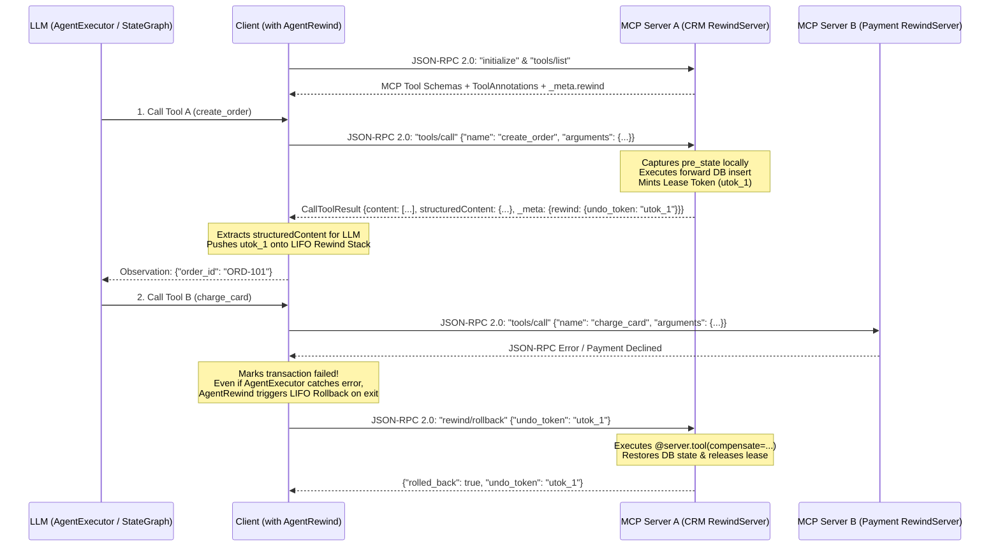

# ⏪ AgentRewind (`agent-rewind`)

[](https://github.com/mustafaderyol/agent-rewind/actions/workflows/ci.yml)
[](https://www.python.org/downloads/)
[](pyproject.toml)
[](LICENSE)

**Zero-Trust Transactional Rollback, Server-Defined Compensation & Multi-Agent Saga Runtime for Model Context Protocol (`MCP`), Google `A2A`, `LangChain` & `LangGraph` (`Ctrl+Z` for AI Agents).**

> 📖 **Core Architecture & Implementation Guide:** Read **[Complete Guide: Writing Transactional MCP Servers, AI Agents & Multi-Agent Graphs (`docs/mcp-and-remote-server-guide.md`)](docs/mcp-and-remote-server-guide.md)** or jump directly to the **[Wiki Guides (`wiki/Home.md`)](wiki/Home.md)**:
> 1. **[How to Build a Transactional MCP Server (`RewindServer`)](wiki/01-How-to-Build-an-MCP-Server.md)**
> 2. **[How to Build a Transactional AI Agent (`AgentExecutor` + `RemoteRunnable` / MCP)](wiki/02-How-to-Build-an-Agent.md)**
> 3. **[How to Build a Transactional Multi-Agent Graph (`StateGraph` + Google A2A)](wiki/03-How-to-Build-a-Multi-Agent-Graph.md)**

---

## 💡 Why `agent-rewind`?

In real-world enterprise architectures, **the AI Agent (Client) does not own the remote databases**. When an LLM dynamically calls remote tools or remote sub-agents across separate microservices (CRM, ERP, Payment Gateway, Email/Slack) via **MCP**, **LangChain `RemoteRunnable`**, or **Google A2A**:
1. **The LLM dynamically decides which tools or sub-agents to call and in what order** at runtime.
2. **Only the remote MCP server knows how to safely undo its own database mutations** (capturing pre-state snapshots, restoring rows, releasing locks).
3. **If Step 3 crashes (`503 Timeout`) or gets hijacked by Indirect Prompt Injection**, standard agents leave Step 1 and Step 2 permanently mutated in your production databases and leak premature confirmation emails.

**`agent-rewind`** extends the official **[`mcp`](https://github.com/modelcontextprotocol/python-sdk)**, **[`a2a-sdk`](https://github.com/a2aproject/a2a)**, **[`langchain`](https://github.com/langchain-ai/langchain)**, and **[`langgraph`](https://github.com/langchain-ai/langgraph)** SDKs without reinventing any protocol:



---

## 📦 Installation

```bash
pip install agent-rewind
# Or with uv:
uv add agent-rewind
```

---

## 🛠️ The 3 Core Workflows: MCP Server, Agent, and Graph

### 1️⃣ How to Build & Stand Up a Transactional MCP Server (`RewindServer`)

> 📚 **Detailed Guide:** [docs/mcp-and-remote-server-guide.md](docs/mcp-and-remote-server-guide.md) | [wiki/01-How-to-Build-an-MCP-Server.md](wiki/01-How-to-Build-an-MCP-Server.md)

[`RewindServer`](src/agent_rewind/server.py) directly subclasses **`mcp.server.mcpserver.MCPServer`** from the official `mcp` SDK. You define `@server.tool(compensate=..., pre_state=..., deferred=...)` **privately on the remote server** so the client agent never needs to know how your database rolls back:

```python
from typing import Any
from agent_rewind import RewindServer

# Directly subclasses `mcp.server.mcpserver.MCPServer` from the official `mcp` SDK
server = RewindServer(name="crm-and-erp-mcp-server", version="0.2.0", default_lease_ttl=120.0)

ORDERS_DB: dict[str, dict[str, Any]] = {}
STOCK_DB: dict[str, int] = {"SKU-100": 50}


# 1. Server-Side Compensation for Order Creation
async def undo_create_order(args: dict[str, Any], result: dict[str, Any], pre_state: Any) -> None:
    ORDERS_DB.pop(result["order_id"], None)

@server.tool(
    name="remote_create_order",
    description="Creates a new order in the remote CRM database.",
    compensate=undo_create_order,
)
async def create_order(customer: str, sku: str, qty: int) -> dict[str, Any]:
    order_id = f"ORD-{len(ORDERS_DB) + 101}"
    ORDERS_DB[order_id] = {"customer": customer, "sku": sku, "qty": qty}
    return {"order_id": order_id, "status": "CREATED"}


# 2. Server-Side Pre-State Snapshot + Compensation for Inventory Update
async def snapshot_stock(args: dict[str, Any]) -> int:
    return STOCK_DB.get(args["sku"], 0)

async def undo_reserve_stock(args: dict[str, Any], result: dict[str, Any], pre_state: int) -> None:
    STOCK_DB[args["sku"]] = pre_state

@server.tool(
    name="remote_reserve_stock",
    description="Reserves stock in the remote warehouse ERP.",
    pre_state=snapshot_stock,
    compensate=undo_reserve_stock,
)
async def reserve_stock(sku: str, qty: int) -> dict[str, Any]:
    STOCK_DB[sku] -= qty
    return {"sku": sku, "remaining": STOCK_DB[sku]}


# 3. Irreversible Notification Buffered in Outbox Until Commit
@server.tool(
    name="remote_send_email",
    description="Sends an order confirmation email (Buffered until transaction commits).",
    deferred=True,
)
async def send_email(to: str, subject: str) -> dict[str, Any]:
    return {"sent": True, "to": to}


# ---------------------------------------------------------------------------
# Stand Up & Deploy Your Remote MCP Server (5 Supported Modes):
# ---------------------------------------------------------------------------
# Mode 1: Official MCP Streamable HTTP Server
if __name__ == "__main__":
    server.run(transport="streamable-http", host="0.0.0.0", port=8000)

# Mode 2: Standalone FastAPI + Uvicorn (Serves MCP `POST /mcp` + LangServe `POST /{tool}/invoke`)
# app = server.create_fastapi_app()
# Terminal: uvicorn mcp_server:app --host 0.0.0.0 --port 8000

# Mode 3: Mount onto an existing FastAPI application
# app.include_router(server.create_fastapi_router())

# Mode 4: Official MCP Server-Sent Events (SSE)
# server.run(transport="sse", host="0.0.0.0", port=8000)

# Mode 5: Official MCP `stdio` Transport (Claude Desktop / Cursor / Stdio Clients)
# server.run(transport="stdio")
```

---

### 2️⃣ How to Build a Transactional AI Agent (`AgentExecutor` + `RemoteRunnable` / MCP)

> 📚 **Detailed Guide:** [docs/mcp-and-remote-server-guide.md](docs/mcp-and-remote-server-guide.md) | [wiki/02-How-to-Build-an-Agent.md](wiki/02-How-to-Build-an-Agent.md)

When building a LangChain `AgentExecutor` that connects to remote tools via `RemoteRunnable` (or `RemoteMCPGateway`), wrap your remote tools with **`rewind_tools([...])`** and run `agent_executor.invoke(...)` inside **`with AgentRewind() as tx:`**. Notice that **the client contains zero compensation code**:

```python
import os
from langchain_openai import ChatOpenAI
from langchain.agents import AgentExecutor, create_tool_calling_agent
from langchain_core.prompts import ChatPromptTemplate, MessagesPlaceholder
from langchain_core.runnables import RemoteRunnable

from agent_rewind import AgentRewind, rewind_tools

os.environ["OPENAI_API_KEY"] = "your-api-key"

# 1. Connect to Remote Tools via LangChain RemoteRunnable
remote_order_tool = RemoteRunnable("https://your-remote-service.com/remote_create_order")
remote_stock_tool = RemoteRunnable("https://your-remote-service.com/remote_reserve_stock")
remote_payment_tool = RemoteRunnable("https://your-remote-service.com/remote_charge_card")

# 2. Wrap with `rewind_tools()` — ZERO compensation code needed on the client!
#    Automatically captures `_meta.rewind.undo_token` from the remote server.
tools = rewind_tools([
    remote_order_tool,
    remote_stock_tool,
    remote_payment_tool,
])

# 3. Standard LLM & Prompt Definition
llm = ChatOpenAI(model="gpt-4o", temperature=0)

prompt = ChatPromptTemplate.from_messages([
    ("system", "You are a helpful assistant. Use the remote tools when needed."),
    MessagesPlaceholder("chat_history", optional=True),
    ("human", "{input}"),
    MessagesPlaceholder("agent_scratchpad"),
])

# 4. Standard Agent & AgentExecutor Creation
agent = create_tool_calling_agent(llm, tools, prompt)
agent_executor = AgentExecutor(agent=agent, tools=tools, verbose=True)

if __name__ == "__main__":
    # 5. Execute inside `with AgentRewind() as tx:`
    #    Whatever tool sequence the LLM chooses, if any step fails (even if caught
    #    internally by AgentExecutor!), all prior remote tools roll back in LIFO order!
    with AgentRewind() as tx:
        response = agent_executor.invoke({
            "input": "Create an order for 2x SKU-100, reserve the stock, and charge the card."
        })
        print(response["output"])
```

#### Connecting `AgentExecutor` Directly to MCP Servers via URL Auto-Discovery (`RemoteMCPGateway`)
```python
from agent_rewind import AgentRewind, RemoteMCPGateway

# Discovers tools over MCP JSON-RPC 2.0 (`tools/list`) and wires rollback hooks automatically:
mcp = await RemoteMCPGateway.discover([
    "https://crm-mcp.company.com",
    "https://erp-mcp.company.com",
    "https://payment-mcp.company.com",
])

tools = mcp.as_langchain_tools()
agent = create_tool_calling_agent(llm, tools, prompt)
agent_executor = AgentExecutor(agent=agent, tools=tools, verbose=True)

async with AgentRewind() as tx:
    response = await agent_executor.ainvoke({"input": "Process order and payment."})
```

---

### 3️⃣ How to Build a Transactional Multi-Agent Graph (`StateGraph` + `RemoteRunnable` / Google A2A)

> 📚 **Detailed Guide:** [docs/mcp-and-remote-server-guide.md](docs/mcp-and-remote-server-guide.md) | [wiki/03-How-to-Build-a-Multi-Agent-Graph.md](wiki/03-How-to-Build-a-Multi-Agent-Graph.md)

When a LangGraph `StateGraph` supervisor routes tasks across multiple remote sub-agents (`remote_1` -> `remote_2` -> `remote_3` via `RemoteRunnable` or **Google A2A** `tasks/send` & `tasks/cancel`):
1. Wrap each remote sub-agent client with **`rewind_agent(...)`**.
2. Wrap `workflow.compile()` with **`rewind_graph(...)`**.
3. On each remote sub-agent server, wrap the sub-agent with **`RewindSubAgentHost`** (or **`RewindA2AExecutor`**) to bundle all of its internal tool calls into a single composite `undo_token`.

```python
from typing import Literal, TypedDict
from langchain_core.messages import AIMessage, HumanMessage
from langchain_openai import ChatOpenAI
from langchain_core.runnables import RemoteRunnable
from langgraph.graph import END, START, StateGraph

from agent_rewind import rewind_agent, rewind_graph

class AgentState(TypedDict):
    messages: list
    sender: str
    next_step: str

local_llm = ChatOpenAI(model="gpt-4o", temperature=0)

# 1. Wrap RemoteRunnable or Google A2A sub-agents with `rewind_agent()`
remote_agent_1 = rewind_agent(RemoteRunnable("https://remote-service-1.com/agent"), name="remote_1")
remote_agent_2 = rewind_agent(RemoteRunnable("https://remote-service-2.com/agent"), name="remote_2")
remote_agent_3 = rewind_agent(RemoteRunnable("https://remote-service-3.com/agent"), name="remote_3")

def local_supervisor_node(state: AgentState):
    prompt = "Analyze the task and choose the next agent: remote_1, remote_2, remote_3, local_worker, or FINISH."
    response = local_llm.invoke(state["messages"] + [HumanMessage(content=prompt)])
    return {"next_step": response.content.strip()}

def local_worker_node(state: AgentState):
    response = local_llm.invoke(state["messages"])
    return {"messages": [response], "sender": "local_worker"}

def remote_node_1(state: AgentState):
    res = remote_agent_1.invoke({"messages": state["messages"]})
    return {"messages": [AIMessage(content=str(res))], "sender": "remote_1"}

def remote_node_2(state: AgentState):
    res = remote_agent_2.invoke({"messages": state["messages"]})
    return {"messages": [AIMessage(content=str(res))], "sender": "remote_2"}

def remote_node_3(state: AgentState):
    res = remote_agent_3.invoke({"messages": state["messages"]})
    return {"messages": [AIMessage(content=str(res))], "sender": "remote_3"}

workflow = StateGraph(AgentState)

workflow.add_node("supervisor", local_supervisor_node)
workflow.add_node("local_worker", local_worker_node)
workflow.add_node("remote_1", remote_node_1)
workflow.add_node("remote_2", remote_node_2)
workflow.add_node("remote_3", remote_node_3)

workflow.add_edge(START, "supervisor")

workflow.add_conditional_edges(
    "supervisor",
    lambda x: x["next_step"],
    {
        "local_worker": "local_worker",
        "remote_1": "remote_1",
        "remote_2": "remote_2",
        "remote_3": "remote_3",
        "FINISH": END,
    },
)

workflow.add_edge("local_worker", "supervisor")
workflow.add_edge("remote_1", "supervisor")
workflow.add_edge("remote_2", "supervisor")
workflow.add_edge("remote_3", "supervisor")

# 2. Wrap `workflow.compile()` with `rewind_graph()`
multi_agent_system = rewind_graph(workflow.compile())

if __name__ == "__main__":
    initial_state = {
        "messages": [HumanMessage(content="Execute complex distributed multi-agent task.")],
        "sender": "user",
        "next_step": "",
    }
    # If remote_3 fails, remote_2 and remote_1 (and all internal tools inside them!)
    # are automatically rolled back in strict LIFO order!
    result = multi_agent_system.invoke(initial_state)
    print(result["messages"][-1].content)
```

---

## 🔌 Built on Official Protocol SDKs (`mcp`, `a2a-sdk`, `langchain`, `langgraph`)

`agent-rewind` **never reinvents existing agent protocols**. It depends directly on the official SDKs, subclassing their official base classes and extending their standard metadata and cancellation hooks:

| Protocol / Ecosystem | Official SDK Base Class Extended | Standard Envelope Extended | Automatic LIFO Rollback Mechanism |
| :--- | :--- | :--- | :--- |
| **Model Context Protocol (`mcp`)** | `RewindServer(mcp.server.mcpserver.MCPServer)` | `mcp.types.CallToolResult.meta["rewind"]` & `Tool.meta["rewind"]` | Official `MCPServer.call_tool("_rewind_rollback")` & `rewind/rollback` |
| **Google A2A (`a2a-sdk`)** | `RewindA2AExecutor(a2a.server.agent_execution.AgentExecutor)` | `a2a.types.Task.metadata["rewind"]` & `REWIND_A2A_EXTENSION` | Official `AgentExecutor.cancel(context, event_queue)` & `tasks/cancel` |
| **LangGraph (`langgraph`)** | `RewindStateGraph(langgraph.graph.StateGraph)` & `RewindToolNode(ToolNode)` | `AIMessage.response_metadata["rewind"]` | `RewindStateGraph.compile()` / `rewind_graph()` rewinds all prior sub-agents in LIFO order |
| **LangChain (`langchain-core`)** | `TransactionalRunnable(langchain_core.runnables.Runnable)` | `_meta.rewind.undo_token` | In-band rollback token dispatch on `with AgentRewind():` exit |

---

## ✨ Enterprise Safeguards Included Out-of-the-Box

| Feature | Description |
| :--- | :--- |
| **🏢 Server-Defined Compensation (`RewindServer`)** | Define `@server.tool(compensate=..., pre_state=...)` privately on remote MCP servers; clients roll back via opaque `undo_token` leases with zero knowledge of server internals. |
| **📭 Transactional Outbox (`deferred=True`)** | Buffers irreversible actions (emails, webhooks, Slack notifications) in memory and flushes them **only** after the entire transaction commits. |
| **🛡️ CaMeL Taint Tracking & PolicyGuard** | Isolates untrusted text in a tool-less `QuarantinedExtractor`, tracks recursive taint in `DataVault`, and blocks poisoned arguments (`deny_tainted`, `require_trusted_match`) or out-of-order LLM tool calls (`require_sequence`, `requires_prior`). |
| **🔖 Nested Savepoints (`tx.savepoint`)** | Roll back a failing sub-branch (e.g., fallback from Express Air to Ground Shipping) without aborting earlier valid remote steps. |
| **💳 Financial Idempotency & Circuit Breakers** | SHA-256 deduplication prevents double-charging on LLM retries; `max_value` enforces hard financial limits; `require_approval` adds Human-in-the-Loop (HITL) sign-off. |
| **🚑 Dead-Letter Queue (`DLQ`) & Lease TTL** | Exponential backoff retries for compensations, `replay_dlq()` recovery, and `ServerLeaseManager` Dead-Man's Switch for crashed agent clients. |

---

## 📊 Benchmark Summary (1,000 Distributed Workflows + Micro-Benchmark)

Evaluated across 4 distributed services (`crm`, `erp`, `payment`, `notify`) over 5 failure & attack modes (250 runs per architecture = 1,000 workflows):

- **Kernel Overhead:** **~62 µs/op** (`14,300+ ops/sec`) in-memory execution overhead.

| Architecture | Cross-System Consistency | Prompt Injection Blocked | Premature Emails Leaked | Dirty Rollback Overwrites | Median Latency (`P50`) |
| :--- | :---: | :---: | :---: | :---: | :---: |
| **1. Naive ReAct Agent** | 20.0% | 0.0% | 200 / 200 | 50 / 50 | 0.08 ms |
| **2. LLM-Rollback Agent** | 20.0% | 0.0% | 200 / 200 | 50 / 50 | 0.11 ms |
| **3. `agent-rewind` (`RewindServer`)** | **100.0%** | **100.0%** | **0 / 200** | **0 / 50** | **0.24 ms** |
| **4. `agent-rewind` (MCP Auto-Discovery)** | **100.0%** | **100.0%** | **0 / 200** | **0 / 50** | **0.31 ms** |

See [wiki/Benchmarks.md](wiki/Benchmarks.md) for the full methodology and reproduction steps.

---

## 📚 Documentation & Wiki

### Documentation (`docs/`)
- 🌟 **[MCP Server, Agent & Multi-Agent Graph Guide (`docs/mcp-and-remote-server-guide.md`)](docs/mcp-and-remote-server-guide.md)** — **The flagship end-to-end guide** on building transactional MCP servers (`RewindServer`), LangChain agents (`AgentExecutor`), and LangGraph multi-agent workflows (`StateGraph` + A2A).
- **[Getting Started Guide (`docs/getting-started.md`)](docs/getting-started.md)** — Installation, standing up your first `RewindServer`, and connecting an agent.
- **[Framework Integrations (`docs/framework-integrations.md`)](docs/framework-integrations.md)** — LangChain `AgentExecutor`, LangGraph `StateGraph`, Google A2A, and HITL webhooks.
- **[Storage & Transports (`docs/storage-and-transports.md`)](docs/storage-and-transports.md)** — Zero-DB `InMemoryBackend`, `JSONFileBackend`, `CallbackBackend`, and `StdlibHTTPTransport`.
- **[Real-World Scenarios Catalog (`docs/scenarios-catalog.md`)](docs/scenarios-catalog.md)** — Detailed walkthrough of 7 enterprise failure modes and patterns.

### GitHub Wiki (`wiki/`)
- **[Wiki Home (`wiki/Home.md`)](wiki/Home.md)**
- **[1. How to Build a Transactional MCP Server (`wiki/01-How-to-Build-an-MCP-Server.md`)](wiki/01-How-to-Build-an-MCP-Server.md)**
- **[2. How to Build a Transactional AI Agent (`wiki/02-How-to-Build-an-Agent.md`)](wiki/02-How-to-Build-an-Agent.md)**
- **[3. How to Build a Transactional Multi-Agent Graph (`wiki/03-How-to-Build-a-Multi-Agent-Graph.md`)](wiki/03-How-to-Build-a-Multi-Agent-Graph.md)**
- **[Remote MCP Auto-Discovery (`wiki/Remote-MCP-Auto-Discovery.md`)](wiki/Remote-MCP-Auto-Discovery.md)**
- **[Architecture Deep Dive (`wiki/Architecture-Deep-Dive.md`)](wiki/Architecture-Deep-Dive.md)**
- **[Security & PolicyGuard (`wiki/Security-and-Policy-Guard.md`)](wiki/Security-and-Policy-Guard.md)**
- **[Benchmarks (`wiki/Benchmarks.md`)](wiki/Benchmarks.md)**

### Runnable Examples (`examples/`)
Explore all 10 self-contained runnable scripts in [`examples/README.md`](examples/README.md):
1. [`examples/01_remote_mcp_server_quickstart.py`](examples/01_remote_mcp_server_quickstart.py) — Standing up a `RewindServer(MCPServer)` and executing a transactional agent workflow against it.
2. [`examples/02_distributed_four_systems_saga.py`](examples/02_distributed_four_systems_saga.py) — 4-Server MCP Cluster (`crm`, `erp`, `payment`, `notify`) with Prompt Injection & 503 crash rollback.
3. [`examples/03_remote_mcp_autodiscovery.py`](examples/03_remote_mcp_autodiscovery.py) — Zero-config URL-only MCP discovery (`RemoteMCPGateway.discover`).
4. [`examples/04_live_packet_trace_simulation.py`](examples/04_live_packet_trace_simulation.py) — Live JSON-RPC packet & kernel trace inspector.
5. [`examples/05_savepoints_and_partial_rollback.py`](examples/05_savepoints_and_partial_rollback.py) — Nested savepoints (`tx.savepoint`) across remote MCP tools for shipping fallback.
6. [`examples/06_financial_idempotency_and_hitl.py`](examples/06_financial_idempotency_and_hitl.py) — Financial idempotency, `max_value` ceiling, and HITL approval on remote MCP calls.
7. [`examples/07_dlq_and_crash_recovery.py`](examples/07_dlq_and_crash_recovery.py) — Dead-Letter Queue (`replay_dlq`) and `ServerLeaseManager` TTL expiry.
8. [`examples/08_server_defined_compensation.py`](examples/08_server_defined_compensation.py) — Multi-team `RewindServer` microservices with opaque `undo_token` rollback.
9. [`examples/09_langchain_remote_runnable_agent.py`](examples/09_langchain_remote_runnable_agent.py) — **LangChain `RemoteRunnable` + `AgentExecutor` with server-defined compensation (`rewind_tools`)**.
10. [`examples/10_langgraph_multi_agent_and_a2a.py`](examples/10_langgraph_multi_agent_and_a2a.py) — **LangGraph Multi-Agent Supervisor (`StateGraph`) + Google A2A (`tasks/send` & `tasks/cancel`) + `RewindSubAgentHost`**.

---

## 🧪 Development & Benchmarking

```bash
# Run the unit and integration test suite
uv run --extra dev pytest -v

# Run the self-contained Micro-Benchmark + 1,000-Workflow Chaos & Security Suite
uv run python benchmarks/benchmark_suite.py
```

---

## 🤝 Contributing & License

Contributions are welcome! Please read [CONTRIBUTING.md](CONTRIBUTING.md) and [SECURITY.md](SECURITY.md) before submitting a Pull Request.

Licensed under the [MIT License](LICENSE).
