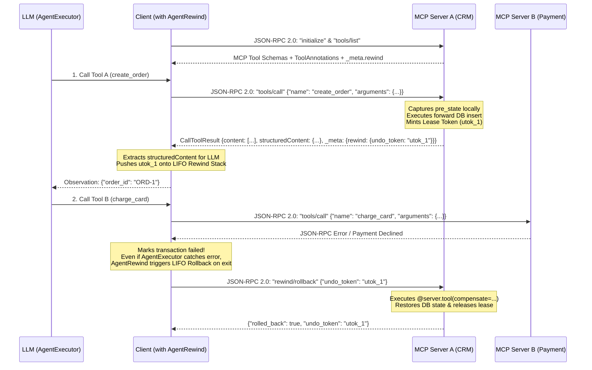

# Complete Guide: Writing Transactional MCP Servers (`RewindServer`) & Client Agents

In real-world enterprise architectures, **the AI Agent (Client) does not own the remote databases**. When an LLM calls remote tools hosted on separate microservices (CRM, ERP, Billing, Inventory) via the **Model Context Protocol (MCP)** or LangChain's `RemoteRunnable`:

1. **The LLM dynamically decides which tools to call and in what order** at runtime.
2. **Only the remote MCP server knows how to safely undo its own database mutations** (capturing pre-state snapshots, restoring rows, releasing locks).
3. **If any step fails**, every previously executed tool across all remote servers must be rolled back in strict **LIFO (Last-In, First-Out)** order without leaking compensation logic into the LLM prompt or client code.

`agent-rewind` solves this natively over the **Official Model Context Protocol (MCP) JSON-RPC 2.0 specification (`2024-11-05` / `2025-03-26`)** using **`RewindServer`** (on the server) and **`RemoteMCPGateway` / `rewind_tools` / `AgentRewind`** (on the client).

---

## Architecture Overview: MCP JSON-RPC 2.0 + `_meta.rewind.undo_token`



---

## Step 1: How to Write & Stand Up a Transactional MCP Server (`RewindServer`)

[`RewindServer`](../src/agent_rewind/server.py) directly subclasses **`mcp.server.mcpserver.MCPServer`** from the official [`modelcontextprotocol/python-sdk`](https://github.com/modelcontextprotocol/python-sdk) package and supports **5 production deployment modes**:
1. **Official MCP Streamable HTTP Server:** `server.run(transport="streamable-http", host="0.0.0.0", port=8000)`
2. **Official MCP SSE Server:** `server.run(transport="sse", host="0.0.0.0", port=8000)`
3. **Standalone FastAPI / Uvicorn Server (MCP + LangServe `RemoteRunnable`):** `app = server.create_fastapi_app()`
4. **Mounting onto an Existing FastAPI App:** `app.include_router(server.create_fastapi_router())`
5. **Official MCP `stdio` Transport:** `server.run(transport="stdio")` (or `server.run_stdio()`)

### `mcp_server.py` (Remote MCP Server Definition)

```python
from typing import Any
from agent_rewind import RewindServer

# Directly subclasses `mcp.server.mcpserver.MCPServer`
server = RewindServer(name="crm-and-erp-mcp-server", version="0.2.0", default_lease_ttl=120.0)

# Simulated Remote Databases
ORDERS_DB: dict[str, dict[str, Any]] = {}
STOCK_DB: dict[str, int] = {"SKU-100": 50}

# 1. Define Server-Side Compensation for Order Creation
async def undo_create_order(args: dict[str, Any], result: dict[str, Any], pre_state: Any) -> None:
    ORDERS_DB.pop(result["order_id"], None)

@server.tool(
    name="remote_create_order",
    description="Creates a new order in the remote CRM database.",
    compensate=undo_create_order,
)
async def create_order(customer: str, sku: str, qty: int) -> dict[str, Any]:
    order_id = f"ORD-{len(ORDERS_DB) + 1}"
    ORDERS_DB[order_id] = {"customer": customer, "sku": sku, "qty": qty}
    return {"order_id": order_id, "status": "CREATED"}


# 2. Define Server-Side Pre-State Snapshot + Compensation for Inventory Update
async def snapshot_stock(args: dict[str, Any]) -> int:
    return STOCK_DB.get(args["sku"], 0)

async def undo_reserve_stock(args: dict[str, Any], result: dict[str, Any], pre_state: int) -> None:
    STOCK_DB[args["sku"]] = pre_state

@server.tool(
    name="remote_reserve_stock",
    description="Reserves stock in the remote warehouse ERP.",
    pre_state=snapshot_stock,
    compensate=undo_reserve_stock,
)
async def reserve_stock(sku: str, qty: int) -> dict[str, Any]:
    STOCK_DB[sku] -= qty
    return {"sku": sku, "remaining": STOCK_DB[sku]}
```

---

### How to Stand Up & Deploy `mcp_server.py`

#### Deployment Mode 1: Official MCP Streamable HTTP (`server.run`)
Launch directly using the inherited `MCPServer.run` method from `mcp`:
```python
if __name__ == "__main__":
    server.run(transport="streamable-http", host="0.0.0.0", port=8000)
```
Or expose the Starlette ASGI app to `uvicorn` / `gunicorn`:
```python
app = server.streamable_http_app()
# Terminal: uvicorn mcp_server:app --host 0.0.0.0 --port 8000 --workers 4
```

#### Deployment Mode 2: FastAPI + LangServe `RemoteRunnable` (`create_fastapi_app`)
When you want a single server to simultaneously serve **MCP JSON-RPC 2.0 (`POST /mcp`)**, **REST discovery (`GET /mcp/tools`)**, and **LangChain `RemoteRunnable` (`POST /{tool_name}/invoke`)**:
```python
app = server.create_fastapi_app(title="Enterprise Transactional MCP Server")
# Terminal: uvicorn mcp_server:app --host 0.0.0.0 --port 8000
```
Or mount onto your existing `FastAPI` service:
```python
from fastapi import FastAPI

app = FastAPI()
app.include_router(server.create_fastapi_router())
```

#### Deployment Mode 3: Official MCP Server-Sent Events (`SSE`)
```python
if __name__ == "__main__":
    server.run(transport="sse", host="0.0.0.0", port=8000)
```

#### Deployment Mode 4: Official MCP `stdio` Transport (Claude Desktop / Cursor / Stdio Clients)
```python
if __name__ == "__main__":
    server.run(transport="stdio")
```

#### Deployment Mode 5: Mounting onto Another `MCPServer` Instance (`mount_to_fastmcp`)
If you already have an existing `mcp.server.mcpserver.MCPServer` instance, mount `RewindServer` onto it:
```python
from mcp.server.mcpserver import MCPServer
from agent_rewind import RewindServer

existing_mcp = MCPServer("enterprise-mcp")
rewind_srv = RewindServer("enterprise-mcp")

@rewind_srv.tool(compensate=undo_create_order)
async def create_order(customer: str, sku: str, qty: int) -> dict:
    ...

# Registers all @rewind_srv.tool functions + _rewind_rollback + _rewind_commit!
rewind_srv.mount_to_fastmcp(existing_mcp)
```

### Supported MCP JSON-RPC 2.0 Methods on `RewindServer`

| JSON-RPC 2.0 Method | Direction | Description |
| :--- | :---: | :--- |
| `initialize` | Client -> Server | Negotiates MCP protocol version (`2024-11-05`) and advertises `capabilities.tools` + `capabilities.experimental.rewind`. |
| `notifications/initialized` | Client -> Server | Standard MCP session initialization notification. |
| `ping` | Client -> Server | Health check returning `{}`. |
| `tools/list` | Client -> Server | Returns MCP `Tool` schemas with `inputSchema`, `annotations` (`readOnlyHint`, `destructiveHint`, `idempotentHint`), and `_meta.rewind`. |
| `tools/call` | Client -> Server | Executes the tool, captures `pre_state` on the server, mints a leased `undo_token`, and returns an MCP `CallToolResult` (`content`, `structuredContent`, `isError`, `_meta.rewind.undo_token`). Also supports `name="_rewind_rollback"` for pure `tools/call` clients. |
| `rewind/rollback` | Client -> Server | Executes the server-side compensation bound to `params.undo_token` and releases the lease. |
| `rewind/commit` | Client -> Server | Finalizes the server lease for `params.undo_token`. |

---

## Step 2: How to Write the Client (`AgentExecutor` + MCP / `RemoteRunnable`)

### Pattern 1: Connecting to MCP Servers via `RemoteMCPGateway` + `AgentExecutor`

```python
from langchain_openai import ChatOpenAI
from langchain.agents import AgentExecutor, create_tool_calling_agent
from langchain_core.prompts import ChatPromptTemplate, MessagesPlaceholder
from agent_rewind import AgentRewind, RemoteMCPGateway

async def main():
    # 1. Discover tools over MCP JSON-RPC 2.0 (`POST /mcp` -> `tools/list`)
    mcp = await RemoteMCPGateway.discover([
        "https://crm-mcp.company.com",
        "https://erp-mcp.company.com",
        "https://payment-mcp.company.com",
    ])

    # 2. Export discovered MCP tools directly for LangChain AgentExecutor
    tools = mcp.as_langchain_tools()

    llm = ChatOpenAI(model="gpt-4o", temperature=0)
    prompt = ChatPromptTemplate.from_messages([
        ("system", "You are a helpful assistant. Use the remote MCP tools to complete the task."),
        MessagesPlaceholder("chat_history", optional=True),
        ("human", "{input}"),
        MessagesPlaceholder("agent_scratchpad"),
    ])

    agent = create_tool_calling_agent(llm, tools, prompt)
    agent_executor = AgentExecutor(agent=agent, tools=tools, verbose=True)

    # 3. Execute inside `async with AgentRewind() as tx:`
    async with AgentRewind() as tx:
        response = await agent_executor.ainvoke({
            "input": "Create an order for 2x SKU-100, reserve stock, and charge the card."
        })
        print(response["output"])
```

### Pattern 2: Connecting via LangChain `RemoteRunnable` + `rewind_tools`

If your client connects to `RewindServer` using LangChain's `RemoteRunnable`:

```python
import os
from langchain_openai import ChatOpenAI
from langchain.agents import AgentExecutor, create_tool_calling_agent
from langchain_core.prompts import ChatPromptTemplate, MessagesPlaceholder
from langchain_core.runnables import RemoteRunnable

from agent_rewind import AgentRewind, rewind_tools

os.environ["OPENAI_API_KEY"] = "your-api-key"

# 1. Connect to Remote Tools via LangChain RemoteRunnable
remote_order_tool = RemoteRunnable("https://your-remote-service.com/remote_create_order")
remote_stock_tool = RemoteRunnable("https://your-remote-service.com/remote_reserve_stock")
remote_payment_tool = RemoteRunnable("https://your-remote-service.com/remote_charge_card")

# 2. Wrap with rewind_tools() — ZERO compensation code needed on the client!
#    `rewind_tools` automatically intercepts `_meta.rewind.undo_token` from the remote server.
tools = rewind_tools([
    remote_order_tool,
    remote_stock_tool,
    remote_payment_tool,
])

# 3. Standard LLM & Prompt Definition
llm = ChatOpenAI(model="gpt-4o", temperature=0)

prompt = ChatPromptTemplate.from_messages([
    ("system", "You are a helpful assistant. Use the remote tools to complete the user's request."),
    MessagesPlaceholder("chat_history", optional=True),
    ("human", "{input}"),
    MessagesPlaceholder("agent_scratchpad"),
])

# 4. Standard Agent & AgentExecutor Creation
agent = create_tool_calling_agent(llm, tools, prompt)
agent_executor = AgentExecutor(agent=agent, tools=tools, verbose=True)

if __name__ == "__main__":
    # 5. Execute inside `with AgentRewind() as tx:`
    with AgentRewind() as tx:
        response = agent_executor.invoke({
            "input": "Create an order for 2x SKU-100, reserve the stock, and charge the card."
        })
        print(response["output"])

    print(f"Final Transaction State: {tx.state.value}")
```

---

## Step 3: How to Create a Transactional Multi-Agent Graph (`StateGraph` + Google A2A + `RewindSubAgentHost`)

When building a **Multi-Agent System** (e.g., a LangGraph `StateGraph` where a `supervisor` routes work across `remote_agent_1`, `remote_agent_2`, `remote_agent_3` over LangServe `RemoteRunnable` or **Google A2A Protocol** `tasks/send` / `tasks/cancel`):

1. **On Each Remote Sub-Agent Server (`RewindSubAgentHost` / `RewindA2AExecutor`)**:
   Wrap your sub-agent with [`RewindSubAgentHost`](../src/agent_rewind/protocols.py) (or [`RewindA2AExecutor`](../src/agent_rewind/protocols.py), which subclasses `a2a.server.agent_execution.AgentExecutor`). Even if `remote_agent_1` executes multiple internal tool mutations on its own server, `tx.export_undo_lease()` bundles all of them into a single composite `undo_token` attached to `AIMessage.response_metadata["rewind"]`, MCP `_meta.rewind`, or A2A `Task.metadata.rewind`.
2. **On the Supervisor / Orchestrator (`rewind_agent` + `rewind_graph`)**:
   Wrap each `RemoteRunnable` or A2A client with [`rewind_agent(...)`](../src/agent_rewind/protocols.py) and wrap `workflow.compile()` with [`rewind_graph(...)`](../src/agent_rewind/protocols.py).
   If `remote_3` fails later in the graph, `AgentRewind` automatically rewinds `remote_2` (e.g., via standard A2A `tasks/cancel`) and `remote_1` (unwinding all of its internal tool calls) in strict LIFO order!

```python
from typing import Literal, TypedDict
from langchain_core.messages import AIMessage, HumanMessage
from langchain_openai import ChatOpenAI
from langchain_core.runnables import RemoteRunnable
from langgraph.graph import END, START, StateGraph

from agent_rewind import rewind_agent, rewind_graph

class AgentState(TypedDict):
    messages: list
    sender: str
    next_step: str

local_llm = ChatOpenAI(model="gpt-4o", temperature=0)

# 1. Wrap Remote Sub-Agents with `rewind_agent()`
remote_agent_1 = rewind_agent(RemoteRunnable("https://remote-service-1.com/agent"), name="remote_1")
remote_agent_2 = rewind_agent(RemoteRunnable("https://remote-service-2.com/agent"), name="remote_2")
remote_agent_3 = rewind_agent(RemoteRunnable("https://remote-service-3.com/agent"), name="remote_3")

def local_supervisor_node(state: AgentState):
    prompt = "Analyze the task and choose the next agent: remote_1, remote_2, remote_3, local_worker, or FINISH."
    response = local_llm.invoke(state["messages"] + [HumanMessage(content=prompt)])
    return {"next_step": response.content.strip()}

def local_worker_node(state: AgentState):
    response = local_llm.invoke(state["messages"])
    return {"messages": [response], "sender": "local_worker"}

def remote_node_1(state: AgentState):
    res = remote_agent_1.invoke({"messages": state["messages"]})
    return {"messages": [AIMessage(content=str(res))], "sender": "remote_1"}

def remote_node_2(state: AgentState):
    res = remote_agent_2.invoke({"messages": state["messages"]})
    return {"messages": [AIMessage(content=str(res))], "sender": "remote_2"}

def remote_node_3(state: AgentState):
    res = remote_agent_3.invoke({"messages": state["messages"]})
    return {"messages": [AIMessage(content=str(res))], "sender": "remote_3"}

workflow = StateGraph(AgentState)

workflow.add_node("supervisor", local_supervisor_node)
workflow.add_node("local_worker", local_worker_node)
workflow.add_node("remote_1", remote_node_1)
workflow.add_node("remote_2", remote_node_2)
workflow.add_node("remote_3", remote_node_3)

workflow.add_edge(START, "supervisor")

workflow.add_conditional_edges(
    "supervisor",
    lambda x: x["next_step"],
    {
        "local_worker": "local_worker",
        "remote_1": "remote_1",
        "remote_2": "remote_2",
        "remote_3": "remote_3",
        "FINISH": END,
    },
)

workflow.add_edge("local_worker", "supervisor")
workflow.add_edge("remote_1", "supervisor")
workflow.add_edge("remote_2", "supervisor")
workflow.add_edge("remote_3", "supervisor")

# 2. Wrap `workflow.compile()` with `rewind_graph()`
multi_agent_system = rewind_graph(workflow.compile())

if __name__ == "__main__":
    initial_state = {
        "messages": [HumanMessage(content="Execute complex multi-agent workflow.")],
        "sender": "user",
        "next_step": "",
    }
    result = multi_agent_system.invoke(initial_state)
    print(result["messages"][-1].content)
```


