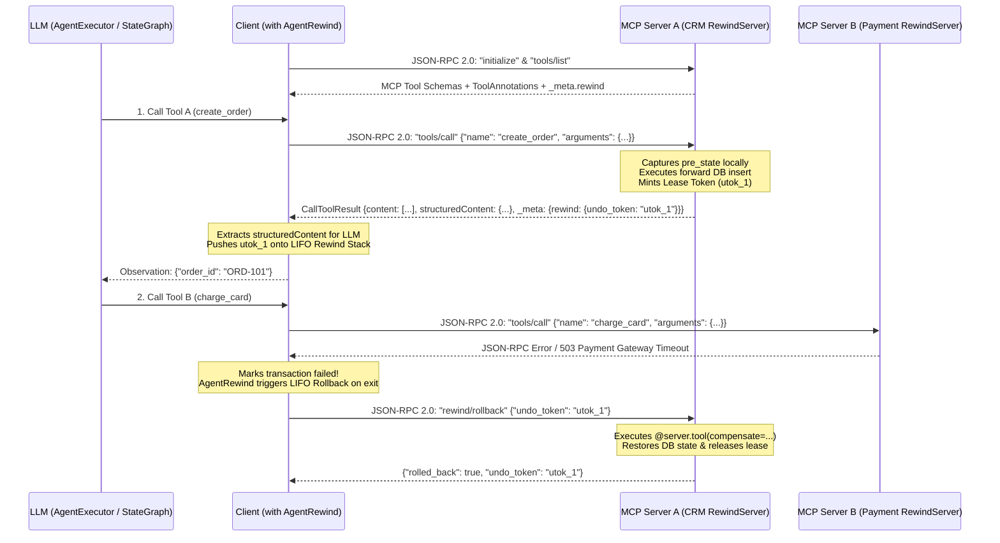

# 1. How to Build & Stand Up a Transactional MCP Server (`RewindServer`)

> **Full Guide Reference:** [`docs/mcp-and-remote-server-guide.md`](../docs/mcp-and-remote-server-guide.md)

In production AI systems, **the AI Agent (Client) does not own the remote databases**. Only the remote MCP microservice (CRM, ERP, Billing, Inventory) knows how to capture pre-state snapshots and safely undo its own database mutations.

`RewindServer` directly subclasses **`mcp.server.mcpserver.MCPServer`** from the official [`modelcontextprotocol/python-sdk`](https://github.com/modelcontextprotocol/python-sdk) package and extends `@server.tool(...)` with server-side compensation, pre-state snapshots, Outbox buffering, and TTL leases.

---

## Architecture: MCP JSON-RPC 2.0 + `_meta.rewind.undo_token`



---

## Step 1: Define Tools & Server-Side Compensations (`mcp_server.py`)

```python
from typing import Any
from agent_rewind import RewindServer

# Directly subclasses `mcp.server.mcpserver.MCPServer` from the official `mcp` SDK
server = RewindServer(
    name="crm-and-erp-mcp-server",
    version="0.2.0",
    default_lease_ttl=120.0,
)

# Simulated Remote Databases owned by this server
ORDERS_DB: dict[str, dict[str, Any]] = {}
STOCK_DB: dict[str, int] = {"SKU-100": 50}


# 1. Server-Side Compensation for Order Creation
async def undo_create_order(args: dict[str, Any], result: dict[str, Any], pre_state: Any) -> None:
    ORDERS_DB.pop(result["order_id"], None)

@server.tool(
    name="remote_create_order",
    description="Creates a new order in the remote CRM database.",
    compensate=undo_create_order,
)
async def create_order(customer: str, sku: str, qty: int) -> dict[str, Any]:
    order_id = f"ORD-{len(ORDERS_DB) + 101}"
    ORDERS_DB[order_id] = {"customer": customer, "sku": sku, "qty": qty}
    return {"order_id": order_id, "status": "CREATED"}


# 2. Server-Side Pre-State Snapshot + Compensation for Inventory Update
async def snapshot_stock(args: dict[str, Any]) -> int:
    return STOCK_DB.get(args["sku"], 0)

async def undo_reserve_stock(args: dict[str, Any], result: dict[str, Any], pre_state: int) -> None:
    STOCK_DB[args["sku"]] = pre_state

@server.tool(
    name="remote_reserve_stock",
    description="Reserves stock in the remote warehouse ERP.",
    pre_state=snapshot_stock,
    compensate=undo_reserve_stock,
)
async def reserve_stock(sku: str, qty: int) -> dict[str, Any]:
    STOCK_DB[sku] -= qty
    return {"sku": sku, "remaining": STOCK_DB[sku]}


# 3. Deferred Outbox Tool (Buffered on Client until Transaction Commits)
@server.tool(
    name="remote_send_email",
    description="Sends an irreversible confirmation email to the customer.",
    deferred=True,
)
async def send_email(to: str, subject: str) -> dict[str, Any]:
    return {"sent": True, "to": to}
```

---

## Step 2: Stand Up & Deploy the MCP Server (5 Ways)

### Option 1: Official MCP Streamable HTTP (`server.run`)
```python
if __name__ == "__main__":
    server.run(transport="streamable-http", host="0.0.0.0", port=8000)
```
Or expose the inherited Starlette ASGI app to `uvicorn`:
```python
app = server.streamable_http_app()
# Terminal: uvicorn mcp_server:app --host 0.0.0.0 --port 8000
```

### Option 2: Standalone FastAPI + LangServe `RemoteRunnable` (`create_fastapi_app`)
Simultaneously serves **MCP JSON-RPC 2.0 (`POST /mcp`)**, **REST tool discovery (`GET /mcp/tools`)**, and **LangChain `RemoteRunnable` (`POST /{tool_name}/invoke`)**:
```python
app = server.create_fastapi_app(title="Enterprise Transactional MCP Server")
# Terminal: uvicorn mcp_server:app --host 0.0.0.0 --port 8000
```

### Option 3: Mount onto an Existing FastAPI Application (`create_fastapi_router`)
```python
from fastapi import FastAPI

app = FastAPI()
app.include_router(server.create_fastapi_router())
```

### Option 4: Official MCP Server-Sent Events (`SSE`)
```python
if __name__ == "__main__":
    server.run(transport="sse", host="0.0.0.0", port=8000)
```

### Option 5: Official MCP `stdio` Transport (Claude Desktop, Cursor, Stdio Clients)
```python
if __name__ == "__main__":
    server.run(transport="stdio")
```

---

## Next Steps
- **[2. How to Build an Agent (`AgentExecutor` + `RemoteRunnable` / MCP)](02-How-to-Build-an-Agent.md)**
- **[3. How to Build a Multi-Agent Graph (`StateGraph` + Google A2A)](03-How-to-Build-a-Multi-Agent-Graph.md)**
