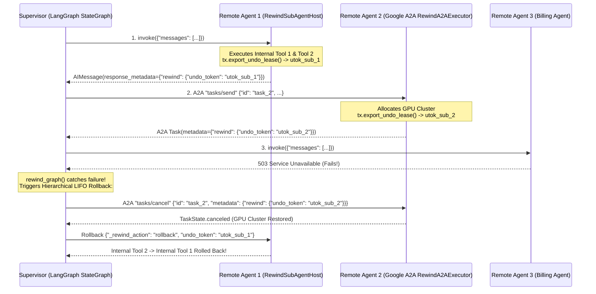

# 3. How to Build a Transactional Multi-Agent Graph (`StateGraph` + `RemoteRunnable` / Google A2A)

> **Full Guide Reference:** [`docs/framework-integrations.md`](../docs/framework-integrations.md) | **Runnable Script:** [`examples/10_langgraph_multi_agent_and_a2a.py`](../examples/10_langgraph_multi_agent_and_a2a.py)

In a **Multi-Agent System** (such as a LangGraph `StateGraph` where a `supervisor` routes work across `remote_agent_1`, `remote_agent_2`, and `remote_agent_3`), each remote sub-agent may execute multiple internal tool calls on its own server.

If `remote_agent_3` fails, **all prior remote sub-agents (`remote_agent_2` -> `remote_agent_1`) and every internal tool mutation inside them must be rolled back in strict LIFO order**.

---

## Architecture: Hierarchical Multi-Agent Saga (`StateGraph` + `RemoteRunnable` + A2A)



---

## Step 1: Build the Supervisor Graph (`StateGraph` + `rewind_agent` + `rewind_graph`)

Take your standard LangGraph `StateGraph` code and make only **two non-intrusive additions**:
1. Wrap each remote sub-agent (`RemoteRunnable` or A2A client) with **`rewind_agent(...)`**.
2. Wrap `workflow.compile()` with **`rewind_graph(...)`** (or use `RewindStateGraph(AgentState)` directly).

```python
from typing import Literal, TypedDict
from langchain_core.messages import AIMessage, HumanMessage
from langchain_openai import ChatOpenAI
from langchain_core.runnables import RemoteRunnable
from langgraph.graph import END, START, StateGraph

from agent_rewind import rewind_agent, rewind_graph

class AgentState(TypedDict):
    messages: list
    sender: str
    next_step: str

local_llm = ChatOpenAI(model="gpt-4o", temperature=0)

# 1. Wrap Remote Sub-Agents with `rewind_agent()`
remote_agent_1 = rewind_agent(RemoteRunnable("https://remote-service-1.com/agent"), name="remote_1")
remote_agent_2 = rewind_agent(RemoteRunnable("https://remote-service-2.com/agent"), name="remote_2")
remote_agent_3 = rewind_agent(RemoteRunnable("https://remote-service-3.com/agent"), name="remote_3")

def local_supervisor_node(state: AgentState):
    prompt = "Analyze the task and choose the next agent: remote_1, remote_2, remote_3, local_worker, or FINISH."
    response = local_llm.invoke(state["messages"] + [HumanMessage(content=prompt)])
    return {"next_step": response.content.strip()}

def local_worker_node(state: AgentState):
    response = local_llm.invoke(state["messages"])
    return {"messages": [response], "sender": "local_worker"}

def remote_node_1(state: AgentState):
    res = remote_agent_1.invoke({"messages": state["messages"]})
    return {"messages": [AIMessage(content=str(res))], "sender": "remote_1"}

def remote_node_2(state: AgentState):
    res = remote_agent_2.invoke({"messages": state["messages"]})
    return {"messages": [AIMessage(content=str(res))], "sender": "remote_2"}

def remote_node_3(state: AgentState):
    res = remote_agent_3.invoke({"messages": state["messages"]})
    return {"messages": [AIMessage(content=str(res))], "sender": "remote_3"}

workflow = StateGraph(AgentState)

workflow.add_node("supervisor", local_supervisor_node)
workflow.add_node("local_worker", local_worker_node)
workflow.add_node("remote_1", remote_node_1)
workflow.add_node("remote_2", remote_node_2)
workflow.add_node("remote_3", remote_node_3)

workflow.add_edge(START, "supervisor")

workflow.add_conditional_edges(
    "supervisor",
    lambda x: x["next_step"],
    {
        "local_worker": "local_worker",
        "remote_1": "remote_1",
        "remote_2": "remote_2",
        "remote_3": "remote_3",
        "FINISH": END,
    },
)

workflow.add_edge("local_worker", "supervisor")
workflow.add_edge("remote_1", "supervisor")
workflow.add_edge("remote_2", "supervisor")
workflow.add_edge("remote_3", "supervisor")

# 2. Wrap `workflow.compile()` with `rewind_graph()`
multi_agent_system = rewind_graph(workflow.compile())

if __name__ == "__main__":
    initial_state = {
        "messages": [HumanMessage(content="Execute complex multi-agent workflow.")],
        "sender": "user",
        "next_step": "",
    }
    # If remote_3 fails after remote_1 and remote_2 succeed,
    # remote_2 and remote_1 are automatically rolled back in LIFO order!
    result = multi_agent_system.invoke(initial_state)
    print(result["messages"][-1].content)
```

---

## Step 2: Host Transactional Remote Sub-Agents (`RewindSubAgentHost` & `RewindA2AExecutor`)

On each remote sub-agent's server (`https://remote-service-1.com/agent`), wrap your sub-agent graph or function with **`RewindSubAgentHost`** (or **`RewindA2AExecutor`**, which subclasses `a2a.server.agent_execution.AgentExecutor` from the official `a2a-sdk`):

```python
from langchain_core.messages import AIMessage
from agent_rewind import RewindA2AExecutor, RewindServer, RewindSubAgentHost

crm_tools = RewindServer("remote-agent-1-tools")

@crm_tools.tool(compensate=lambda args, res: DB["customers"].pop(args["cid"], None))
def upsert_customer(cid: str, tier: str) -> dict:
    DB["customers"][cid] = tier
    return {"cid": cid, "tier": tier}

@crm_tools.tool(compensate=lambda args, res: DB["tickets"].remove(res["ticket_id"]))
def create_onboarding_ticket(cid: str) -> dict:
    tid = f"TCK-{cid}"
    DB["tickets"].append(tid)
    return {"ticket_id": tid}

def remote_subagent_1(payload: dict) -> AIMessage:
    upsert_customer(cid="CUST-42", tier="ENTERPRISE")
    create_onboarding_ticket(cid="CUST-42")
    return AIMessage(content="Remote Agent 1 completed CRM onboarding.")

# Bundles all internal tool mutations into a single composite `undo_token`!
remote_service_1_host = RewindSubAgentHost(remote_subagent_1, name="remote_agent_1")

# Or expose as an official Google A2A `AgentExecutor`:
a2a_executor = RewindA2AExecutor(remote_service_1_host)
```

---

## Next Steps
- **[1. How to Build an MCP Server (`RewindServer`)](01-How-to-Build-an-MCP-Server.md)**
- **[2. How to Build an Agent (`AgentExecutor` + `RemoteRunnable` / MCP)](02-How-to-Build-an-Agent.md)**
